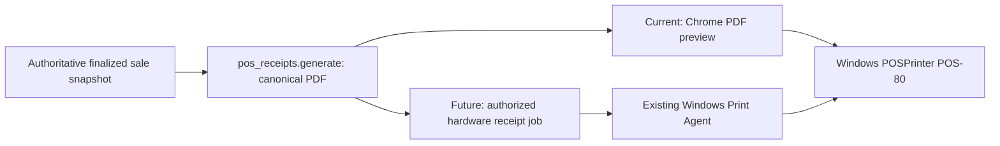

# Phase 4G — manual receipt printing, canonical PDF

## What changed

Previously, receipts were mostly left-aligned text on an estimated-height page, with a single generic preview action. The revised canonical PDF uses a centered PixiePinks text wordmark, monochrome rules, measured Unicode wrapping, right-aligned LKR amounts and an emphasized grand total. Product/variant names wrap; discounts, configured tax description, payment amounts, cash received/change and available customer/contact details come from the existing frozen sale snapshot. Legal IDs appear only when configured. No financial values are recalculated.

80 mm and 58 mm roll pages are measured using the same font metrics before final output. Their MediaBox starts at zero with the exact width and content-dependent height; there is no crop/fit transform or estimated blank tail. The footer has a 5 mm PDF safety margin. A4 remains paginated. Very large roll documents exceeding the existing agent's 1500 mm compatibility limit return a clear error directing staff to A4. Prices are never clipped to fit a column.

The existing Noto Sans and Sinhala fonts remain embedded with text shaping. Branding is crisp vector text rather than a decorative color image. [The demonstration 80 mm PDF](evidence/phase4g-80mm-sample.pdf) contains synthetic data and is prominently marked SAMPLE / NOT A SALE; it is not a fiscal document or physical-printer certification.

## Cashier instructions — Chrome / Windows

1. Finish the existing authorized checkout process. Wait for **COMPLETE** and verified payment. An uncertain/pending/failed sale does not offer a finalized sale receipt. Do not create another checkout to obtain a receipt.
2. In Sale status, choose **Print Receipt (80 mm)**. This defaults to 80 mm and opens the authorized PDF. If Chrome blocks/closes the preview, use **Open receipt PDF** or **Download receipt PDF** in the same section; there is no need to create another sale.
3. In Chrome's PDF viewer, press Print / Ctrl+P. Choose the existing **POSPrinter POS-80** queue. Confirm the already installed 80 mm roll, actual size / 100% scale, correct orientation and appropriate existing driver paper form. Do not print the whole CRM HTML page or select **4BARCODE 3B-365B** for receipts.
4. Review the print preview for clipping/shrinkage or a wrong paper length before sending it. The PDF already has its own margins. Browser/driver “fit to printable area”, fixed-length forms or extra margins may alter output; verify the supported actual-size controls without silently reconfiguring the Windows driver.
5. Press Print, then inspect the actual paper/cut. PDF generation, a preview window or a downloaded file does **not** confirm physical printing. The browser cannot silently select a printer, print, sense the paper or report drawer position.
6. For 58 mm or A4, select the optional format and choose **Preview selected format**. A4 needs a suitable A4 printer. The primary 80 mm button always uses 80 mm.
7. For a reprint, use **Sales & returns → Open receipt / status → Print Receipt (80 mm)**. Subsequent successful PDF generations are clearly marked **DUPLICATE / REPRINT**, including when an earlier PDF was only previewed and the Windows print dialog was cancelled. Opening/downloading an already prepared link does not generate another receipt/audit event.
8. Refunds remain separate: only after verified refund and confirmed payout is **Print Refund Receipt (80 mm)** available. It identifies the refund, original sale, returned items, amount and confirmed payout. It does not masquerade as another paid sale.

If the receipt PDF fails, the UI shows the existing authorization/state error or a useful connection/PDF error and re-enables the controls. Retry from the same sale or Sales History after resolving the issue. A failed PDF render does not consume an original receipt audit identity. Never retry financial checkout because a preview failed.

## Important: manual Windows cash-drawer behavior

**Current Windows driver settings may open the drawer for any receipt print or reprint, including card-only or bank-transfer receipts. That behavior is independent of CRM payment eligibility and is not CRM-controlled drawer security.** Browser receipt printing cannot enforce the future controlled drawer rules.

This change does not modify cashbox settings, pulses, queue permissions, cutter settings, feed distance or driver installation. Keep `POS_CASH_DRAWER_AUTOMATION_ENABLED=false`. Any separate review/change of the current driver policy needs the authorized Windows administrator; this task does not perform it. Do not claim that browser reprints keep the drawer closed when the driver is configured to kick after every print.

The future controlled agent architecture still separates the normal receipt queue from the isolated drawer queue and its cash-only/manual-authorization/no-replay controls. Those controls have not been enabled or weakened here.

## One generator, two delivery paths

`POST /crm/pos/api/sales/{id}/receipt/pdf` retains its POST/CSRF/auth contract and `{profile, refund_id}` body, private/no-store inline PDF response, completed-sale checks and refund paid-out checks. `generate(..., commit=False, duplicate=...)` remains compatible with `hardware_service.receipt_job`. Hardware identities, routing, idempotency and authorization are unchanged. Browser and hardware consume the same rendered content with their existing duplicate/audit distinctions; there is no browser-only PDF template.

Rendering uses frozen source data; successful generation appends the existing `RECEIPT_GENERATED` audit with the existing duplicate/profile/refund fields. Rendering now finishes before that audit is committed, so an unsuccessful PDF does not falsely consume an original. No existing audit/history rows are edited. A hardware caller still flushes inside its job transaction and commits atomically as before.

The browser action never enqueues a hardware job, calls a pairing endpoint or dispatches a drawer action. Railway ingress, proxy configuration, pairing, agent credentials/tasks/activation and all existing gates remain untouched. PR #181/#182 protections remain intact; `PRINT_AGENT_RAILWAY_ISOLATED_INGRESS_ENABLED` is not enabled. Browser printing does not require the agent.

## Release and physical acceptance

No migration, dependency upgrade, environment-variable change, Shopify scope or hardware activation is required. Deploy only after normal review/approval. Versioned static URLs ensure existing cashier browsers load the new controls; reload the POS page after release.

Automated tests use fake Shopify and printer interfaces; no physical output was produced. The sample was visually reviewed as a 203 dpi PDFium raster, which verifies layout appearance, not the actual Windows driver/device. An authorized operator should physically validate:

- Exact 80 mm width / 100% scale and readable English/Sinhala at the printer's actual resolution.
- Short receipt and long names/multiple items, correct quantity/unit/line amounts and unclipped totals/footer.
- Actual variable-length form behavior, bottom margin, and the existing cutter/feed configuration. Some driver forms can add feed beyond PDF content height; the application does not reconfigure them.
- One preview-to-print and Sales History duplicate, including popup-blocked link fallback; inspect paper rather than assuming preview success means printed.
- Separate optional 58 mm and A4 paper/printer configurations where used.
- Actual driver cashbox behavior, with awareness that it can kick on any manual print/reprint. No live test transaction or drawer action is authorized by these development tests.

Use the clearly marked synthetic sample for separately authorized layout checks. Normal financial acceptance must use existing approved procedures, never fabricated production COMPLETE states.

## Rollback

Revert the Phase 4G commit through the normal approved release procedure and reload the POS to restore the earlier layout/UI. There is no schema/data rollback. Retain receipt audits and finalized sale records; do not delete them, reset hardware attempts, create another order or change payment/Shopify data to undo a print. Existing generated PDFs/print previews retain their prior content. Railway/security/hardware flags and Windows configuration remain unchanged on rollback.
