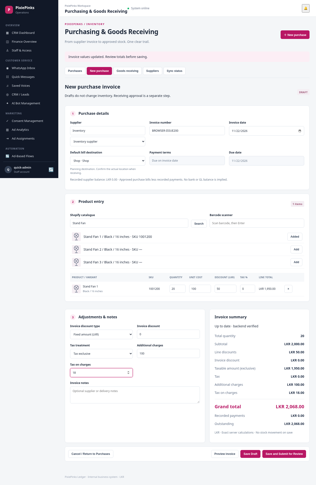

# Purchasing UI upgrade and destination correction

Baseline: main `9599f4c` (merged PR201). No database migration, new feature gates or Shopify writes are introduced.

## Destination diagnosis

PR201's context endpoint queried only shop-scoped `PurchaseRecord(kind=LOCATION)` records. Shopify locations were available through a separate administrator-only setup endpoint, but the new-purchase screen offered no warning or setup link when no mappings existed. The frontend filtered `payload.enabled` and rendered `type + location_id`; it never joined current active Shopify locations to show their names. Thus an imported catalogue or working inventory location list did not populate purchase destinations automatically. This is verified from source and reproduced in fixtures; the actual production mapping inventory has not been inspected here.

The correction retains the existing mappings and actual Shopify IDs. On screen load the context endpoint reads the existing Shopify location client, joins complete active results to mappings **in the configured shop**, and returns names plus `verified_active`. Only enabled, currently verified mappings can be selected; no implicit first/default location is chosen. Empty/unavailable/inactive lists have a setup warning, with an administrator-only **Configure Locations** link to the existing Sync status → Configure Locations panel (`/crm/retail/purchases#locations`). Read-location failures are distinct from a successful empty list. Existing mappings gain no database changes; verified names are also saved in location JSON on explicitly authorized configuration saves for later display.

Bill save/edit and receipt creation/approval recheck active Shopify locations through the existing client. A disabled, foreign-shop, nonexistent or inactive mapping cannot be saved as a destination. Financial preview uses the local mapping only and **does not** call Shopify per keystroke; preview is not live-location authorization. Save/receiving revalidation remains mandatory. A location becoming inactive after the screen opens fails closed without discarding form entries.

## Staff workflow

* Purchases → New purchase. Search supplier by name/phone; select supplier explicitly. Credit terms, calculated due date and recorded supplier purchase balance appear. Balance covers approved bills minus recorded supplier payments, not bank/GL/POS balances.
* Select the **default bill destination** by verified name and Shop/Warehouse purpose. This is planning metadata; each delivery has its own **actual receiving destination**.
* Search imported product name, SKU or barcode, or focus the scanner field and scan + Enter. Shared barcodes remain choices; no ambiguous auto-selection. Shopify CDN thumbnails are reused. The same variant cannot be added twice; different variants with the same SKU remain separate identities.
* Enter quantity, unit purchase cost, fixed line discount and tax percentage. Change invoice discount (fixed/percentage), tax treatment, charges and charge tax. Every edit requests a CSRF-protected, read-only Decimal preview. Stale responses cannot replace newer totals. No floating-point financial calculation runs in the browser. Product tax and charge tax are displayed separately; grand total is not recomputed client-side.
* Preview invoice opens a structured unsaved review. Save Draft records the draft only. Save and Submit for Review performs the existing save followed by the existing submit action, with no approval. If submission fails after save, the UI identifies the saved draft and keeps its reference; it never creates a replacement bill. Double submission is fenced in the frontend as well as existing request/business identities.
* Recoverable validation errors retain fields, rows and stable request keys. Cancel confirms discarding unsaved changes. Navigation warns before leaving a dirty invoice; browser unload warns too. Draft editing retains the original ID/version controls.
* View invoice shows supplier, dates, destination, line costs/discounts/taxes, totals, status, received/remaining quantities, payments/balance and audit evidence. Existing frozen bill JSON is not rewritten to add display fields.
* Receive goods shows ordered, previously approved delivered and remaining quantities. Accepted/damaged/rejected are separate; their sum cannot exceed remaining units. Partial receipts need a unique delivery reference and verified actual location. Existing backend concurrency checks remain authoritative. Saving or submitting never creates stock movements; administrator receiving approval alone creates accepted-only movement/outbox records.

## Security and compatibility

Existing feature gates, permissions, authentication, CSRF, request identities, supplier invoice/delivery/payment uniqueness, immutable records, inventory delta/CAS and uncertainty fencing are preserved. The new preview endpoint requires purchasing prepare permission. Location setup remains administrator-only. No new Shopify catalogue records, SKUs, barcodes, prices, receipt jobs, payments, journals or financial operations are created by preview/context reads. No source changes to the inventory dispatcher, POS, barcode system or Shopify adapter.

Preview summary fields are display additions using the same Decimal/cents rules as saved quotes. Existing bills get copied display-only summary values; their persisted snapshots/totals remain unchanged. Staged loading or a failed connection does not manufacture a location or authorize stock writes.

## Deployment and remaining prerequisites

1. Review the draft PR and screenshots/tests; obtain separate release approval. Deploy the reviewed commit through the existing process. **No migration is needed**; head stays `20261122_53`. Keep all existing production variables and write gates unchanged. This PR does not authorize inventory synchronization.
2. Authorized administrator opens `/crm/retail/purchases#locations`, clicks Read actual Shopify locations, selects a real active location, chooses Shop/Warehouse and saves an enabled mapping if none exists. Existing mappings can be edited with their loaded version. This is a separately authorized configuration action, not performed by this implementation task. Do not create fake IDs or remap historic movements.
3. Reopen/refresh purchasing and confirm actual names. If verification is unavailable, check the existing Shopify connection/read_locations permission through established read-only diagnostics. Do not add credentials or enable write flags as a workaround.
4. With stock-write gates remaining unchanged/off, test draft entry and read-only preview, validation, submission and review under administrator and staff permissions. Verify no stock movement before receipt approval. Receiving approval/live inventory testing still needs its existing separate authorization and safety process.
5. Hard-refresh affected browsers after deployment so updated CSS/JS loads. Existing manual stock/finance/printing behavior is unchanged.

Rollback: restore the previous reviewed application build under release approval; no schema downgrade or data repair is required. Extra location names and quote/display fields are backward compatible. Never delete mappings, rewrite frozen bills or replay inventory jobs to roll back this UI. Preserve existing write settings and uncertainty fences. If rolling back further than PR201, follow its stricter shared inventory gate rollback instructions.

## Screenshots and tests

Screenshots are from disposable synthetic fixtures (mock catalogue thumbnails, no customers/production data). Desktop is Chromium **1366×768**; mobile **390×844**, with stacked line rows and settled navigation transition. Images are in `docs/screenshots/purchasing-ui/`.

Final test results are recorded in the draft PR. Coverage includes empty/inactive/disabled destinations, named mappings, scope, unavailable reads, Decimal previews, supplier/product selectors, scan + Enter, duplicate item and double-submit fences, recoverable validation, partial receiving, permissions and unchanged stock-before-approval behavior. Relevant inventory, barcode, POS, finance and WhatsApp regressions run only against disposable databases/mocks.

### Validation results

* Broad purchasing/inventory/adapter/PostgreSQL/barcode/import/POS/finance/WhatsApp run: **359 passed**, no failures or skips.
* Final purchasing service/API/PostgreSQL and Chromium suite: **53 passed**, including six browser flows; counts overlap the broad run.
* Desktop/mobile screenshots were visually reviewed. Whole-page mobile width and closed-navigation position are asserted, in addition to component width. JavaScript syntax, Python compilation, `git diff --check` and unchanged Alembic head were checked.

### Screenshot gallery

[Desktop invoice entry, 1366×768 viewport](screenshots/purchasing-ui/purchase-desktop.png) · [Mobile stacked entry](screenshots/purchasing-ui/purchase-mobile.png) · [Structured invoice review](screenshots/purchasing-ui/invoice-review.png) · [Missing destination / administrator setup](screenshots/purchasing-ui/destination-setup.png)

