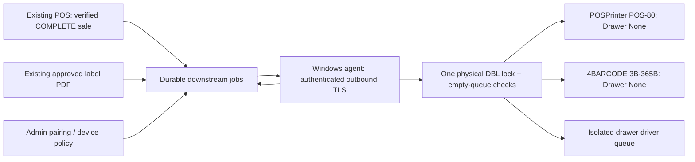

# Phase 4F — local Windows printing and drawer control

## Release boundary

This extends the deployed POS, not its order/payment/inventory implementation. All development uses fake Shopify and Windows interfaces. No production journal, sale, refund, stock adjustment, Railway variable or physical printer/drawer command was issued. Actual Windows 11 driver, security-account, printer and drawer acceptance remains outstanding. This Linux development environment cannot produce or sign a tested Windows installer; source and Windows build/startup scripts are supplied, not a claimed executable installer.

Three **new** dispatch gates default false:

```text
POS_LOCAL_PRINT_ENABLED=false
POS_CASH_DRAWER_AUTOMATION_ENABLED=false
RETAIL_HARDWARE_LABEL_PRINT_ENABLED=false
```

Existing POS_ENABLED/POS_CHECKOUT_WRITE_ENABLED/POS_REFUND_WRITE_ENABLED, barcode synchronization and inventory settings are unchanged. In particular, this feature is not authorization to turn on checkout/refund writes. Preserve the existing Railway values, including the owner's enabled POS UI and disabled checkout/refund gates.

Migration **20261120_48**, parent **20261119_47**, adds `print_devices`, `hardware_jobs`, `hardware_events`, `hardware_rates`. Jobs have immutable source/device/register/location/profile/PDF identity, a single delivery/dispatch-permit fence and append-only audit. Downgrade intentionally retains evidence. After approved release, back up and run `alembic upgrade head` before starting the new application. No journal or catalog migration is performed.

## Architecture



One physical DBL USB printer has **two normal Windows queues**: receipts exclusively `POSPrinter POS-80`, labels exclusively `4BARCODE 3B-365B`. The owner selected a third **isolated control queue** named `PixiePinks Drawer Control (POS-80)` using the same tested POS-80 driver and USB port. This is another logical queue, not another physical printer. Both normal queues remain Drawer=None. The isolated queue uses only the manufacturer's Windows driver Cashbox #1 after-print behavior, verified locally; **no ESC/POS kick bytes, pins, voltage or pulse timings are guessed**.

The drawer action prints a small fixed non-financial control slip through that isolated queue. It is not a second sales receipt. This mechanism consumes a small additional strip/cut; physically accept that behavior before activation. Reprints and labels can never target that queue. The cashier drawer key must be Under Control. A driver test alone is not electrical compatibility evidence beyond the tested installation.

The agent runs under a dedicated non-admin Windows account, different from the cashier/browser user. Only that account and Windows administrators/SYSTEM may access the drawer queue. Windows printer ACLs cannot distinguish the agent from a browser under the **same** user, so using one shared account is not sufficient isolation.

For this one-physical-printer deployment, the server serializes in-flight/uncertain hardware actions across the shop; re-pairing cannot bypass an old register's unresolved action. The agent owns one global Windows mutex for the shared device. It checks all configured queues for pending/error/offline work before claiming/submitting anything. It never automatically cancels Windows jobs. Ordinary applications can bypass the agent's software lock; operators must drain/review both normal queues and stop external printing when switching media or recovering uncertainty. No claim of a global hardware lock against unrelated Windows applications is made.

## Server and agent security

Admin session + CSRF controls enrollment, activation, configuration, rotation and revocation. Short-lived one-time pairing codes expire in five minutes; the device is inactive after pairing until an administrator activates it. One active device is allowed per register. Rotation invalidates old credentials and requires pairing again. Revoked device IDs cannot be reactivated or rotated back into use; create a new enrollment.

The native API uses a separate device bearer token, not Shopify tokens or CRM session cookies. Token and pairing secrets are hashed server-side. Agent credentials and local printer attestation are protected using Windows user-bound DPAPI, with no plaintext fallback or embedded installer secret. The client pins a configured HTTPS origin, verifies normal TLS certificates, follows no redirects, trusts no environment proxy, opens no listening HTTP port and executes no remote command/file path. Browser Origin requests are rejected. Pairing/native traffic is rate-limited with independent DB rows so unauthenticated traffic does not acquire a financial shop lock.

Device access is bound to shop/register/location. Every job uses fixed profile routing, authenticated artifact retrieval, SHA-256/size matching and a single-use dispatch permit immediately before local I/O. PDFs are bounded to 32 MiB and 5,000 pages; geometry and raster memory are checked before spooling. No PDF scripts are executed: PDFium rasterizes into GDI. Receipt/label defaults are not globally edited with SetPrinter. Per-job DCs inherit locally attested private driver settings and change only public page dimensions/copy count. Driver/port/effective per-user DEVMODE fingerprints include vendor DriverData; exposed settings changes block dispatch until reattestation. This is not a claim to detect every undocumented registry/firmware setting; physical acceptance remains necessary.

The companion's normal receipt/label queues must share a local USB/DOT4 port. FILE:/virtual/network mappings are not accepted as the DBL shared device. Optional A4 invoices require a separate suitable configured queue, attested locally and explicitly selected in A4 media mode; no A4 hardware is assumed to exist. A4 layout label batches keep their existing browser/PDF fallback; the DBL local label path accepts roll batches only.

## Downstream job semantics

The existing POS worker and hardware preparation are isolated: hardware errors never change COMPLETE, create another Shopify order or call inventory adjustment. POS sale publication and Shopify adapter business logic are unchanged. The receipt generator remains the single financial-document source; the only addition is a non-committing generation option for an atomic downstream job and explicit duplicate marking. Label PDFs are copied exactly from the already preview-confirmed, GENERATED retail print job, preserving its template, barcode, SKU, price and copy count; source barcode safety is rechecked before dispatch.

Automatic originals are opt-in per active device, after administrator enable time, limited to newly COMPLETE sales in the last 24 hours. Existing historical sales are not automatically swept. A unique source key prevents duplicate originals and one unique drawer action per cash sale. Cash, and split tenders containing positive cash, qualify. Card/bank-only sales never create drawer actions. Held, unpaid or uncertain sales cannot create final receipts. Approved paid-in/out may create a separate controlled drawer action when explicitly enabled; it does not create an extra financial movement.

Automatic drawer intents expire within **120 seconds of the original cash checkout/approved movement**, never hours later after delayed verification or reconnection. Closing the original register session prevents any queued drawer dispatch. A cash drawer's exact physical position cannot be sensed by this integration; it reports configured/submitted/operator-observed, not falsely “opened” from Windows acceptance.

States:

- `QUEUED`: eligible, waiting for correct operator-confirmed media, ready queues and active authorized device.
- `DELIVERED_TO_AGENT`: one delivery identity. A separate dispatch permit can be consumed only once.
- `SUBMITTED_TO_PRINTER`: Windows accepted the action; physical output is **not confirmed**.
- `CONFIRMED`: an authorized staff member explicitly inspected the paper or observed the drawer action.
- `FAILED`: a blocked/expired/reviewed action, never automatically retried.
- `UNKNOWN`: delivery/driver/acknowledgement/crash uncertainty; blocks further hardware claims across this shop’s shared physical printer until authorized review.

The local SQLite action journal uses WAL + synchronous=FULL and records INTENT before obtaining the single-use server permit or touching a driver. Crash recovery converts unresolved INTENT to UNKNOWN. Duplicate IDs never execute again. Lost acknowledgements resend only status, not hardware. Each PDF may produce multiple Windows spool IDs (one DC/page for exact page geometry); job names contain only the hardware UUID. Last spool ID is reported; operators can identify all pages by that UUID, never by customer/payment names. Partial batches never automatically resend missing/all pages.

Large batches maintain authenticated progress/heartbeat between pages, bounded by the original expiry and original consumed permit. Progress does not authorize a new attempt. Revocation, gate/config/source changes or unavailable progress stop subsequent work; already submitted physical work cannot be instantly retracted. A driver call that hangs becomes uncertain, not an excuse to replay.

## Staff/admin workflow

Use the POS **Hardware** component for connected/disconnected status, queue-reported readiness, media, last jobs, errors and audit. Hardware unavailability does not block the cart/scanner or normal PDF fallback.

1. Admin: enroll the existing register/location; give the short-lived code to the Windows operator. Activate after pairing. Assign the exact receipt/label profiles, optional isolated drawer/A4 queues and per-device automation policy. No UI control changes Railway dispatch gates.
2. Local Windows administrator: install queues/security/account/driver preferences and attest them under the agent identity using the installation guide.
3. Operator: install the correct physical stock, inspect/drain both queues, and request Receipt or Label mode. The agent acknowledges only when local verification and empty/ready queues agree. This is manual media confirmation, not automatic sensing.
4. COMPLETE sale: an original receipt job is queued if enabled. A recent positive cash component adds exactly one dependent drawer control action. Printing failures do not reverse payment or sale.
5. Open an existing COMPLETE sale to print a local duplicate. It never creates a drawer action. 58/80 width must match device stock policy; A4 requires its separate printer. Browser PDF receipt remains available.
6. Retail → Label Printing: preserve existing preview/confirmation/generation. Choose **Print using PixiePinks Local Printer** on the generated batch and select the assigned device. It waits in Label mode and never opens the drawer. Normal PDF download/printing/physical confirmation remains available.
7. Manual drawer opening requires explicit `pos.drawer.open` permission (and POS view), an open assigned register, verified isolated driver configuration, a reason and fresh unique action ID. Administrator role already has the relevant grants. Staff cannot use an arbitrary printer command.
8. Staff physically confirm printed output in history. Unknown actions require notes and explicit agent/queue inspection; no retry button silently repeats them. Label confirmations also require retail barcode printing access. Admin audit/rotation/revocation and recovery remain available with all three hardware gates off.

## Failure, retention and rollback

- A successful spooler call is not proof of printing, cutting or drawer opening. Paper-out, USB unplug, offline work, spooler errors and partial output require inspection. A lack of Windows status flags can also be stale; see the local diagnostic guide.
- If uncertain: disable the relevant hardware gates as approved, stop the agent task, inspect all queues and physical output, then record the outcome. Do not reset the server attempt/permit, delete the local action journal or reuse a possibly sent drawer ID.
- If another opening is truly needed, an authorized operator creates a new manual action with a new reason after resolving the old one. Receipt recovery creates an explicit DUPLICATE without a drawer action. For partial labels, inspect what printed and create a new preview-confirmed batch for remaining copies; do not replay the uncertain PDF automatically.
- Pending artifacts expire after 24 hours. PDFs are cleared from hardware job blobs after seven days when the hardware worker is enabled; immutable hashes/audit remain. Disabling the integration stops dispatch, not authorization to delete evidence. On permanent retirement, apply the approved artifact-retention procedure while keeping action fences/audit. Device tokens never unlock unlimited historical documents.
- Rollback: independently disable the three new gates, deactivate/revoke the device, stop/uninstall its Windows task, and retain server tables/local action journal. Do not change POS checkout/refund, barcode or inventory gates. Already submitted Windows jobs need physical review; stopping the web process does not prove they did not print/open. No destructive downgrade.

See [Windows installation/offline recovery](windows-print-agent-install.md), [physical acceptance checklist](phase4f-hardware-acceptance.md) and the implementation/test report. Feature branch: `feature/retail-phase4f-hardware-printing`; draft PR only, no automatic merge/deploy/activation.

## Isolated drawer transport prerequisite

The administrator must set the isolated drawer queue to **Print directly to the printer**, turn **Keep printed documents** off, and obtain manufacturer-supported evidence and authorized physical interruption tests showing that USB/spooler recovery does not replay the driver cashbox action. The agent checks the direct/no-retention queue attributes and requires a separate local no-replay attestation. Unknown or unsupported behavior leaves drawer automation blocked; receipts and labels can be accepted independently. The application journal prevents application retries, but cannot establish exactly-once physical behavior inside a Windows driver or printer firmware. No physical interruption test or drawer action was performed during development.
